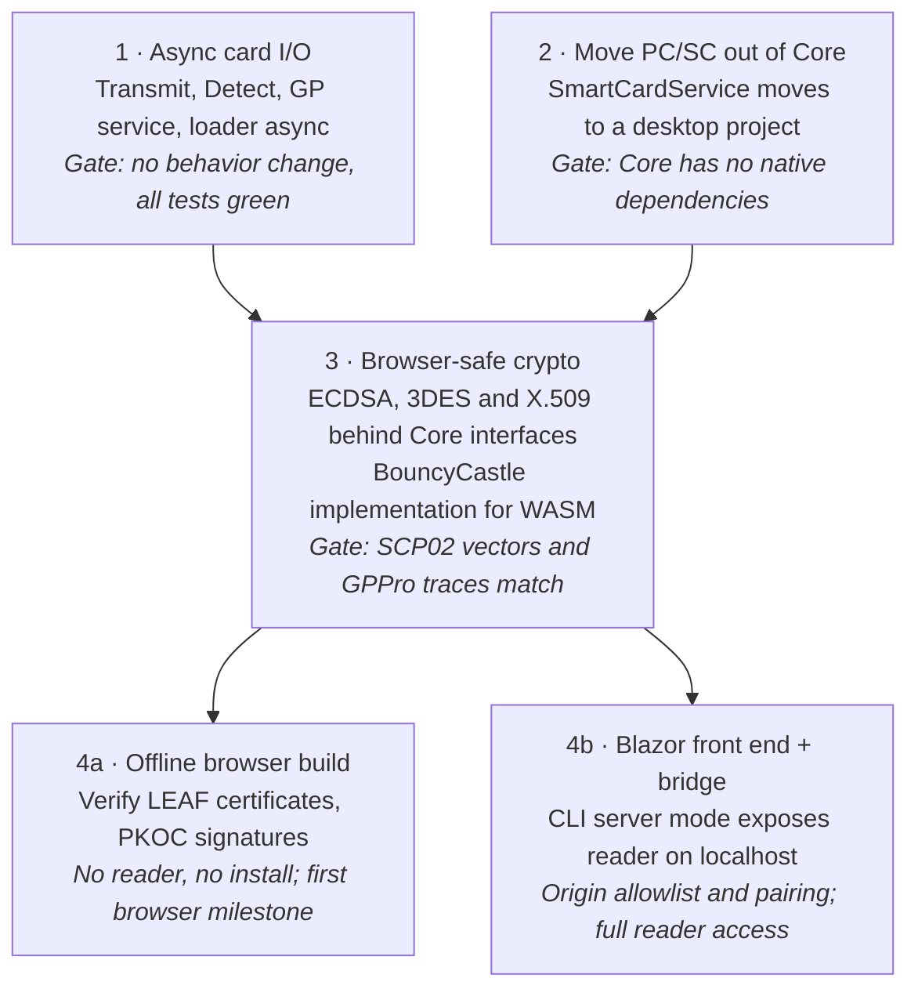

# Cred-Bench in the Browser — WebAssembly Plan

As of 2026-11-05. Status: future consideration, not scheduled.

## Summary

Core can run in the browser on .NET WebAssembly (Blazor), but only after four changes: async card I/O, PC/SC moved out of Core, crypto that works in the browser, and a way for the page to reach the card reader.

The C# compiles to WebAssembly as is. The blockers are what the browser lacks: no PC/SC, most of `System.Security.Cryptography` (ECDSA, DES/3DES, X.509) unsupported, and no blocking I/O on a single thread. Reaching a physical reader still needs a small native helper on the user's machine, so a browser build doesn't remove installs. It removes the platform-specific UI.

The first three changes are worth doing anyway. They make Core cleaner and easier to test even if a browser front end never ships.

## Current state

Core targets `net10.0` and depends only on CommunityToolkit.Mvvm and PCSC (pcsc-sharp). All crypto comes from the .NET standard library. These are the parts that touch the browser blockers:

| Area | Files | Depends on | Works in browser WASM |
| --- | --- | --- | --- |
| Reader access | `Services/SmartCardService.cs` | pcsc-sharp → `winscard.dll` / `libpcsclite` | No |
| Card I/O contract | `Services/ISmartCardService.cs`, `ICardDetector` | Synchronous `Transmit`, `Detect` | No (would deadlock) |
| SCP02 secure channel | `GlobalPlatform/Scp02Session.cs` | `DES`, `TripleDES` | No |
| PKOC / LEAF signature checks | `PKOCDetector.cs`, `LEAFVerifiedDetector.cs`, `LeafPrintedIdLookup.cs` | `ECDsa` (P-256) | No |
| LEAF certificates and trust store | `Leaf/LeafCertificate.cs`, `Leaf/LeafTrustStore.cs` | `X509CertificateLoader`, `System.Formats.Asn1` | X.509: no; ASN.1: yes |
| LEAF test CA | `Leaf/LeafTestCa.cs` | `CertificateRequest`, `ECDsa` | No |
| File input | `CapFileConverter.cs`, `LeafTestCa.cs`, `ProgramCardViewModel.cs` | File system paths | Needs browser file input |
| Detection, TLV parsing, models, ViewModels | Most of Core | Pure managed code | Yes |

The good news: only one file references PCSC, and everything else talks to `ICardConnection`. The transport is already swappable.

## Blockers

Four things stand between Core and the browser. Reader access is the hardest; the other three are engineering work with known solutions.

1. **Reader access.** Browsers have no PC/SC, and WebAssembly can't load native libraries. The page needs a different transport to the reader (see [Reader access options](#reader-access-options)).
2. **Crypto.** In browser WASM, .NET supports hashing, HMAC and a small set of AES and key-derivation functions. `ECDsa`, `DES`/`TripleDES`, X.509 loading and `CertificateRequest` throw `PlatformNotSupportedException`. That breaks PKOC and LEAF signature checks, LEAF certificate parsing, SCP02 (all card programming) and the LEAF test CA. Fix: BouncyCastle, which is pure managed code, behind small Core-owned interfaces.
3. **Synchronous card I/O.** `ISmartCardService.Transmit` and `ICardDetector.Detect` are synchronous. Every browser transport is async, and browser WASM is effectively single-threaded, so blocking on async I/O deadlocks. Fix: make the card API and everything above it (detectors, GP service, applet loader, programmers) async. This also matches the project rule of async for all I/O.
4. **File access.** CAP files, trust anchors and test-CA material are loaded from paths. Fix: take bytes or streams in Core and let each front end supply them (file picker, drag and drop, or embedded resources).

## Reader access options

Recommended: a localhost bridge. It is the only option that works with ordinary readers in ordinary browsers today, at the cost of one small install.

| Option | How it works | Browsers | Install needed | Main risk |
| --- | --- | --- | --- | --- |
| Localhost bridge (recommended) | Native helper (e.g. the CLI in a server mode) exposes the reader over a localhost WebSocket; the page sends APDUs through it | All | Yes, small helper | Origin checks and pairing so other sites can't drive the reader |
| WebUSB + CCID in managed code | Page claims the reader over WebUSB and speaks CCID itself | Chromium only | No | Windows and macOS smart card drivers usually claim the reader first, so WebUSB can't open it |
| Web Smart Card API | Chrome exposes PC/SC directly | Chrome, Isolated Web Apps only | Managed install | In practice limited to ChromeOS and enterprise-managed deployments |

The bridge also fits the existing design: it is a second `ISmartCardService` implementation that forwards `Transmit` over a socket. The CLI already has reader listing and connection code to build it from.

Browser API availability above is from memory and approximate. Re-check Web Smart Card API status before committing.

## Phased plan

Phases 1 and 2 can run in parallel and ship on their own. Phase 3 opens both browser outcomes; 4a needs no bridge, so it is the cheaper first step toward 4b.

## Offline-only variant

Without reader access, a browser build can still be a useful verification tool once Phase 3 (browser-safe crypto) is done. It needs no bridge and no install.

- Paste or upload a LEAF certificate and see it parsed and checked against the trust store
- Paste a PKOC public key and signature and check the signature
- Paste an ATR or an APDU trace and see it decoded
- Inspect a CAP file's components before loading it to a card

This is a cheap first browser milestone and tests the crypto layer on real WASM before the bridge exists.

## Risks, open questions and triggers

**Risks**

- Rewriting SCP02 on BouncyCastle could regress card programming. Mitigate by keeping the current test vectors and checking against GPPro traces on real cards before switching.
- The async conversion touches every detector and the GP chain. Do it as its own change, with no behavior change, before anything browser-specific.
- A bridge that accepts any origin lets any website send APDUs to the user's card. It needs an origin allowlist and a pairing step.
- BouncyCastle adds several MB to the WASM download. Trimming may help; measure before deciding.

**Open questions**

- [ ] Who is the browser user: field techs without admin rights, customers, or internal staff?
- [ ] Is card programming needed in the browser, or only detection and verification?
- [ ] One crypto path everywhere (BouncyCastle on desktop too) or the standard library on desktop and BouncyCastle in the browser?
- [ ] Should the bridge be the existing CLI with a server flag, or a separate helper?

**Revisit when**

- A customer or partner asks for zero-install or Chromebook support
- The Web Smart Card API becomes available to regular web pages
- SCP03 or non-default card keys come up, since both push toward BouncyCastle anyway
